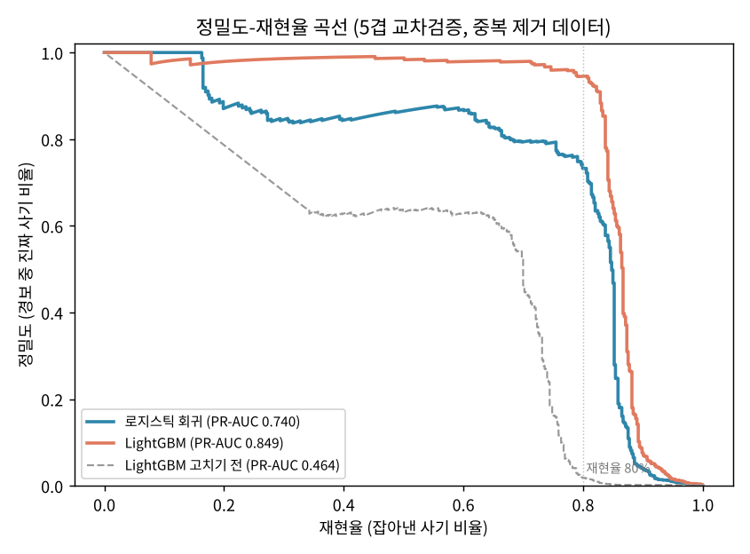

# FDS — 카드 거래 이상거래탐지

공개 카드 거래 데이터로 사기 거래를 탐지하는 모델을 단계별로 만들고, **"점수가 정말 믿을 만한가"**를 하나씩 검증한 프로젝트입니다.
모든 실험 과정·결정·실패 기록은 [`reports/PROJECT_LOG.md`](reports/PROJECT_LOG.md)에 있습니다.

## 한눈에 보는 결과

| 항목 | 결과 |
|---|---|
| 최종 모델 | LightGBM (`min_child_weight=1`, 불균형 처리 없음) |
| PR-AUC (5겹 교차검증) | **0.850 ± 0.013** (로지스틱 회귀 0.742 ± 0.022, 같은 조각끼리 비교 시 5/5 우세) |
| 사기 80%를 잡을 때 오경보 | 로지스틱 회귀 138건 → **LightGBM 22건** (사기 473건 기준) |
| 기준점 | 운영 목표(재현율 80% 또는 오경보 예산)로 정함. 목표는 평균적으로 지켜지지만 조각별 오차가 큼 |



## 데이터

- Kaggle **Credit Card Fraud Detection** (`mlg-ulb/creditcardfraud`, ULB Machine Learning Group): 2013년 9월 유럽 카드 거래 2일치
- 284,807건 중 사기 492건(0.17%). 변수 V1~V28은 원 제공자가 개인정보 보호를 위해 PCA로 변환한 값, 그 외 `Time`, `Amount`
- 완전히 똑같은 거래 1,081건을 제거해 **283,726건(사기 473건)**으로 사용
- 데이터 파일은 저장소에 포함하지 않습니다. 라이선스는 Kaggle 데이터셋 페이지(Open Database License)를 따릅니다

## 평가 방법

- **지표**: 사기가 0.17%뿐이라 정확도는 의미가 없음(전부 '정상'이라 해도 99.83%). **PR-AUC**와 **재현율 80%일 때 정밀도**를 사용
- **5겹 교차검증**(StratifiedKFold, seed 42): 분할 한 번의 점수는 시험지 운에 따라 PR-AUC가 최대 0.16까지 흔들려서, 모든 비교를 5조각 평균 ± 표준편차로 함
- **같은 조각끼리 짝지은 비교**: 점수 자체는 흔들려도 같은 시험지에서의 모델 차이는 안정적이라, 모델 비교는 조각별 차이와 우세 횟수로 판단

## 단계별 결과

| 단계 | 질문 | 결론 | 그림 |
|---|---|---|---|
| 1 | 데이터는 어떻게 생겼고, 정확도는 왜 쓸모없나? | 사기 0.17%, 결측 없음. 아무것도 안 잡아도 정확도 99.83% → PR-AUC 사용 | 01~03 |
| 2-1 | 중복 거래가 점수를 부풀리나? | 테스트 사기의 약 8%가 학습에 똑같은 복사본 존재 → 중복 제거. 점수는 시험지 운으로 크게 흔들림 → 5겹 교차검증 채택 | 04, 05 |
| 2-2 | 트리 모델은 얼마나 나은가? | LightGBM 0.850 vs 로지스틱 0.742, 5/5 우세. 단, 기본 설정에서는 점수 폭주로 0.464까지 무너짐 → `min_child_weight=1`로 해결 | 06, 07 |
| 2-3 | 불균형 처리(가중치·언더샘플링·SMOTE)가 도움이 되나? | 순위(PR-AUC)는 개선 없음(SMOTE ≈ 처리 없음, 언더샘플링 하락, 가중치는 점수 폭주). 대신 점수 크기를 크게 바꿈 → 처리 없음 채택 | 08, 09 |
| 2-4 | 기준점은 어떻게 정하나? 새 데이터에서도 지켜지나? | 학습 조각만으로 고른 기준점은 목표를 평균적으로 지키지만 조각별로 3/5만 달성 | 10 |
| 2-4 보완 | 여유를 두면? | 재현율 85%로 고르면 15/15 지키지만 오경보 10.4배('절벽'), 오경보 예산은 완만한 맞교환 | 11 |

## 문제 해결 기록

- **데이터 누수**: 중복 거래가 학습·테스트에 나뉘어 들어가 점수가 부풀려지는 것을 찾아 제거 (2-1)
- **LightGBM 점수 폭주**: 결과가 조각마다 널뛰고 컴퓨터마다 달라지는 것을 단서로, 원시 점수(log-odds)가 약 25,000까지 폭주해 확률이 0/1로 뭉개지는 것을 진단. 잎 값 = −(기울기 합)/(헤시안 합)에서 헤시안 ≈ 0인 잎이 원인 → `min_child_weight=1`로 해결 (2-2)
- **클래스 가중치의 같은 문제**: 가중치 600배가 위의 보호 장치를 무력화하는 것을 확인. 가중치를 √600≈24로 낮추면 안정되지만 처리 없음보다 낮음 (2-3)
- **기준점 고르기의 누수 방지**: 테스트 데이터를 보지 않도록 학습 조각 안에서 한 번 더 교차검증한 점수로 기준점을 고름 (2-4)

## 실행

FDS 전용 가상환경에서 실행합니다 (다른 파이썬 환경의 라이브러리를 바꾸지 않도록).

```bash
cd ~/fds
python -m venv .venv            # 처음 한 번만
source .venv/bin/activate       # 터미널을 열 때마다
pip install -r requirements.txt # 처음 한 번만 (lightgbm은 맥에서 libomp 필요)
# 데이터: Kaggle "Credit Card Fraud Detection"의 creditcard.csv를 data_raw/에 둔다

python scripts/01_eda.py              data_raw/creditcard.csv reports   # 1단계 탐색
python scripts/02_baseline.py         data_raw/creditcard.csv reports   # 1단계 기본 모델
python scripts/03_duplicates.py       data_raw/creditcard.csv reports   # 2-1 중복 점검
python scripts/03b_seed_stability.py  data_raw/creditcard.csv reports   # 2-1 시드 반복
python scripts/04_tree_model.py       data_raw/creditcard.csv reports   # 2-2 LightGBM
python scripts/05_imbalance.py        data_raw/creditcard.csv reports   # 2-3 불균형 처리
python scripts/06_threshold.py        data_raw/creditcard.csv reports   # 2-4 기준점
python scripts/06b_threshold_margin.py data_raw/creditcard.csv reports  # 2-4 보완 (약 7분)
```

그래프는 결과 JSON으로 다시 그릴 수 있습니다: `python scripts/plot_tree_model.py reports` 등 `plot_*.py`.

## 구조

```
scripts/
  fds_common.py        데이터 로드(중복 제거), 5겹 분할, 지표, LightGBM 설정 — 2-2부터 공통 사용
  01_ ~ 06b_*.py       단계별 실험
  plot_*.py            결과 그래프
reports/
  PROJECT_LOG.md       진행 기록 (현재 상태 + 날짜별 히스토리)
  *_results.json       단계별 결과
  figures/             그래프 01~11
data_raw/              원본 데이터 (저장소에 포함하지 않음)
```

## 앞으로

3. 비지도 이상탐지(Isolation Forest, 오토인코더)와 비교 — 라벨 없이 어디까지 잡히나
4. 시간 순서 분할 + 설명가능성(SHAP) — 과거로 학습해 미래를 예측할 때의 성능, 판단 근거 설명
5. 보안 DB 프로젝트 연동 — 탐지 점수 적재, 알림·대시보드
6. 적대적 공격(탐지 회피) 실험

## 환경

Python 3.9 (macOS), `requirements.txt`의 고정 버전: numpy 2.0.2, pandas 2.3.3, scikit-learn 1.6.1, matplotlib 3.9.4, lightgbm 4.6.0, imbalanced-learn 0.12.4
